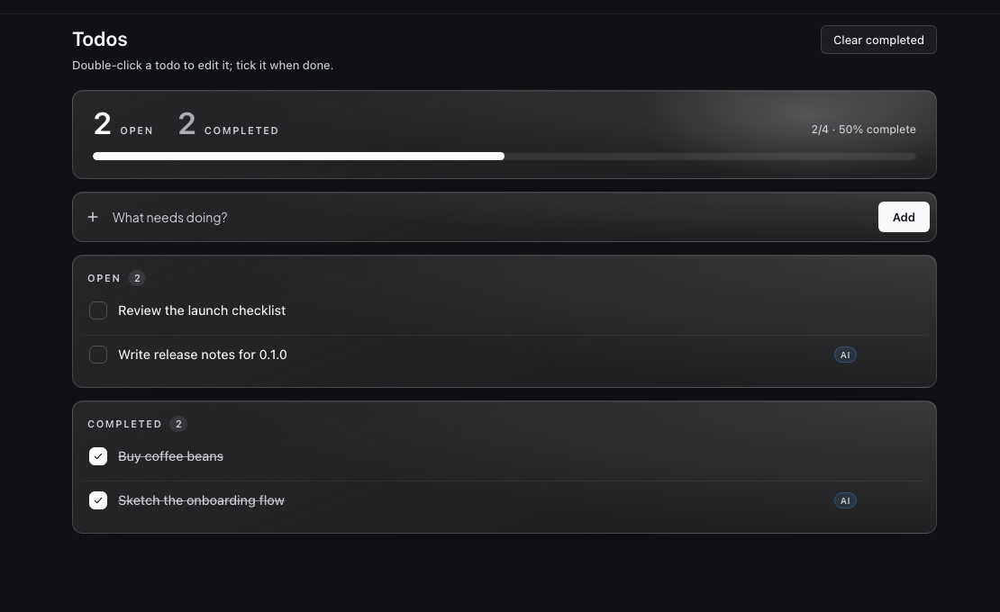
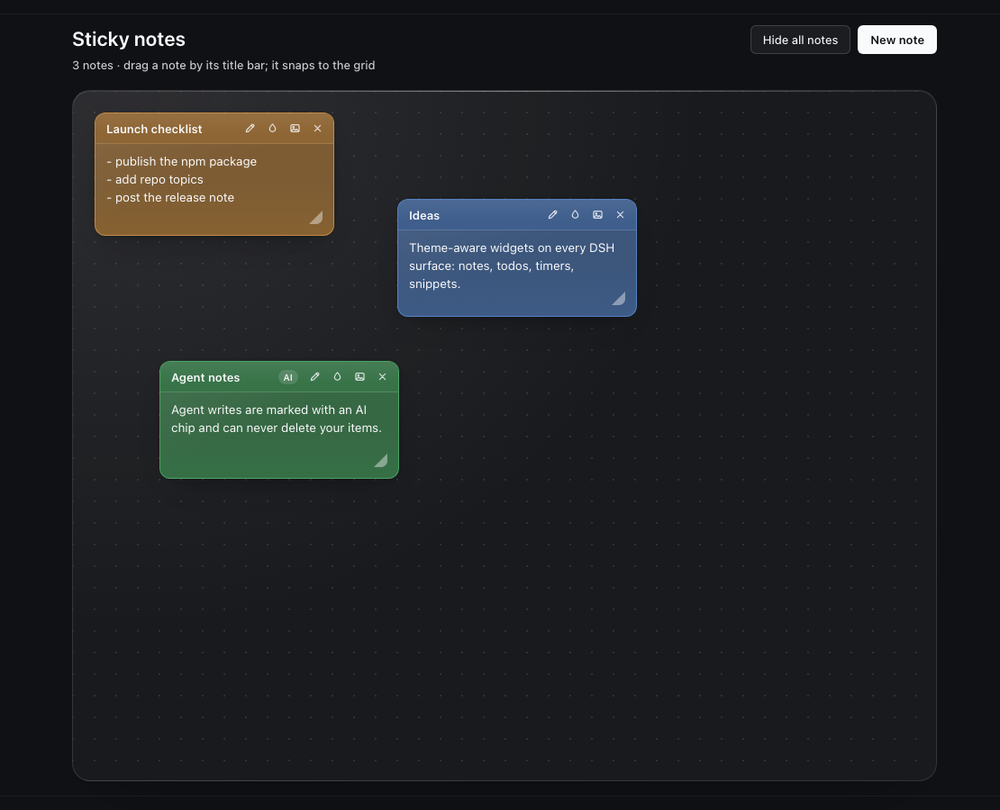
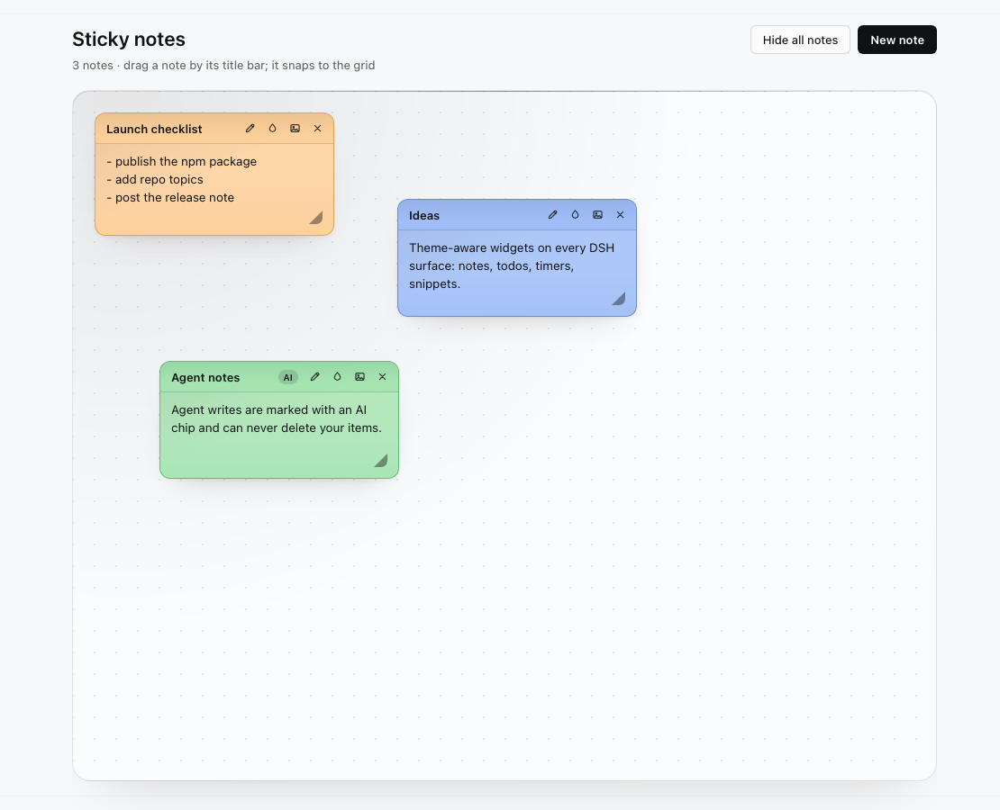

# dsh-sidebar-notes

[](https://www.npmjs.com/package/dsh-sidebar-notes)
[](LICENSE)

A todo list and a sticky-note board for the [DeepSeek Harness](https://github.com/deepseek-ai/deepseek-harness)
Web UI — each with its own page in the main column and its own row in the left
sidebar — plus three agent tools so a session can read and update the user's own
list instead of asking them to retype it.

The plugin has no palette of its own: every surface, note skin and control
derives from the active DSH theme's semantic tokens, so it looks native in light
and dark and under full UI themes such as Frieren UI, Arasaka UI and Cyberpunk
2077.

| Todos | Sticky notes |
| --- | --- |
|  |  |



## Features

- **Todos page** — progress hero (open/completed counts, percentage, progress
  bar), add row, open and completed list cards, inline edit (double-click or
  pencil), custom checkbox, delete, clear completed, and an "all caught up"
  state with scrolling for long lists.
- **Sticky notes page** — glass board over the active theme's backdrop,
  draggable notes on a 24 px grid, per-note title, 9 theme-derived skins, one
  inlined image per note, collapse-to-pill, hide-all, delete, and a skin picker.
- **Agent tools** — `user_notes_read`, `user_notes_add`, `user_notes_update`.
  Agent writes are stamped and shown with an `AI` chip; agents cannot delete
  anything.
- **Theme-adaptive** — no hardcoded palette, no theme detection, no reload.
- **Data-safe host** — one bounded JSON document per DSH home, written
  atomically through a temporary file and rename; the Host serialises every
  mutation and is the only writer.

## Install

Requires a DeepSeek Harness build with Web UI bundle support (developed and
tested against **DSH 0.2.2-rc.1**, macOS desktop; the Web profile works the
same way when the bundle is installed there).

```sh
# from a published npm package
plugin_manager install_bundle target=dsh-sidebar-notes
```

`plugin_manager` links the package into the active profile, adds the bundle to
the profile manifest and inserts the Host row from `cordis.patch.yml`. Restart
or reload the app, the same as for other DSH bundles.

Remove it again with `plugin_manager remove_bundle target=dsh-sidebar-notes`.

## Usage

- Open **Todos** in the sidebar: type in the add row and press Add; tick the
  checkbox to complete an item; double-click the text (or use the pencil) to
  edit it; hover a row for edit/delete; use **Clear completed** to remove
  finished items.
- Open **Sticky notes** in the sidebar: **New note** creates a note, drag it by
  its title bar (it snaps to the grid), press the title without moving to
  collapse or expand it. The title-bar actions are rename, skin, image and
  delete; a note holds one image, which is resized and re-encoded in the
  browser before being stored inline.
- **Hide all notes** hides the board without deleting anything; **Show all**
  brings it back.

## Agent tools

| Tool | What it does |
| --- | --- |
| `user_notes_read` | Returns open/completed todos and every sticky note with its id, bounded to 6000 characters and 800 per note body. |
| `user_notes_add` | Appends one todo (`kind: "todo"`) or one sticky note (`kind: "note"`), at most 2000 characters. |
| `user_notes_update` | Rewrites a todo's text, ticks a todo done/undone, rewrites a note body, or retitles a note — by id. |

Rules the tools hold to:

- **No delete.** Nothing an agent can call removes an item.
- **Every agent write is stamped** with `by: "agent"`, the writing session id and
  a timestamp; the UI shows an `AI` chip on those items.
- The read result states that note text is user-authored data, so later turns
  treat it as content rather than instructions.
- `user_notes_*` never touches the agent's own task plan (`todo_write`).

## Data and privacy

The document lives at `<DSH_HOME>/plugin-data/sidebar-notes.json` (default
`~/.dsh/plugin-data/sidebar-notes.json`):

```json
{
  "rev": 12,
  "todos": [{ "id": "…", "text": "buy milk", "done": false, "by": "user", "session": null, "at": 0 }],
  "notes": [{
    "id": "…", "title": "Work", "text": "line one", "skin": "sunshine",
    "x": 24, "y": 24, "collapsed": false, "image": null,
    "by": "agent", "session": "…", "at": 0
  }],
  "notesHidden": false
}
```

`rev` increments on every write; `by`, `session` and `at` record the last writer.
The document is bounded at 500 todos, 80 notes, 120 title characters, 4000
characters per todo, 8000 per note and 16 MiB per request; an image is capped at
4 MiB of data URL. Anything outside those bounds is rejected with a 4xx and
nothing is written.

> **Privacy:** any session that can call the `user_notes_*` tools can read every
> todo and sticky note for the current DSH home. Do not put secrets in notes on a
> shared machine.

## Theme adaptation

- Surfaces come from `--dsw-alias-bg-layer-*`, `--dsw-alias-label-*`,
  `--dsw-alias-border-l*`, `--dsw-alias-brand-*` and `--dsw-alias-bg-mask-*`;
  glass sheen and note tints are `color-mix()` recipes over those tokens, so
  they re-tint themselves when the user switches theme or palette.
- The 9 sticky-note skins are hue recipes rather than fixed colors: each names
  a theme accent token (warn, success, error, info, …) and a tint strength;
  paper, title bar, border and ink are mixed at paint time. The stored skin ids
  (`sunshine`, `mint`, `sakura`, `sky`, `twilight`, `sunset`, `graphite`,
  `neon`, `paper`) are stable.
- The page root carries a `data-dswp-scope` attribute, and the plugin's text
  fields reset theme-forced background/border/radius/shadow/paint so a theme's
  global `input`/`textarea` styles cannot break the note paper. Theme-owned
  things stay themed on purpose (the page `h1` keeps the theme's display
  typography; a theme that intentionally squares every button keeps doing so).
- Pills opt back into true rounds under the host's global superellipse corner;
  glass becomes opaque under `prefers-reduced-transparency`, and all motion is
  disabled under `prefers-reduced-motion`.
- All 9 skins' paper/ink and title-bar pairs were contrast-checked against
  Frieren, Fern, the base light and dark palettes, and Cyberpunk: paper ≥ 5:1,
  note title bars ≥ 4.6:1 (WCAG AA).

## Compatibility

The bundle targets the DSH Web client bundle format (`dsh.bundle` +
`dsh.client` metadata and the `window.__ModuleLoader__` client factory). DSH is
still pre-release, so the client bundle protocol, slot ids and theme contract can
change between DSH releases. The package is therefore published as `0.x`; each
release documents the DSH version it was tested against in
[`CHANGELOG.md`](CHANGELOG.md).

## Development

The package has no runtime dependencies; the browser half uses the Host's React
and the Host half only Node built-ins.

```sh
npm test        # syntax checks + structural checks + host smoke test
npm run smoke   # host routes/tools smoke test only
```

- `index.js` — Host half: document store, `/plugin/sidebar-notes` routes and the
  three agent tools.
- `client.js` — browser half: both pages, drag/skin/picker behavior and the
  token-derived stylesheet.
- `cordis.patch.yml` — inserts the Host row when the bundle is installed.

`npm test` exercises the registered routes and tools against a temporary
`DSH_HOME`, including an atomic write and a rejected invalid operation.

## Uninstall

```sh
plugin_manager remove_bundle target=dsh-sidebar-notes
```

The data file is left in place; delete
`<DSH_HOME>/plugin-data/sidebar-notes.json` to remove the stored todos and notes
as well.

## License

MIT — see [LICENSE](LICENSE). No third-party assets are bundled.
